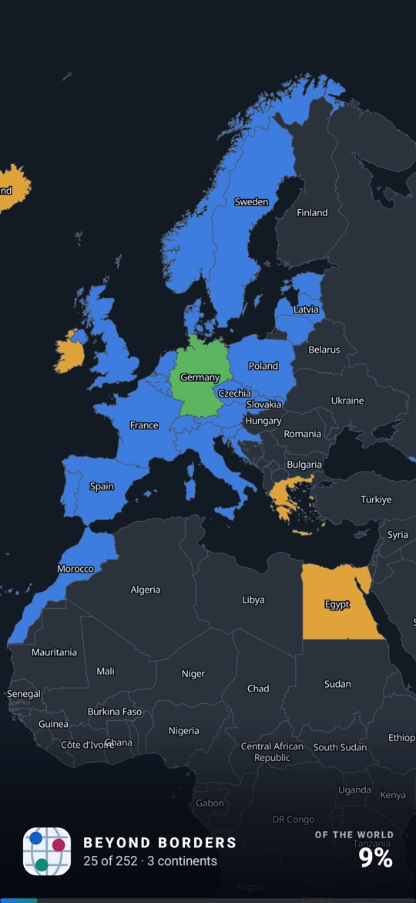

# Beyond Borders

An Android app for tracking where you have been and where your passport gets you
without a visa. Offline, no account, no network permission.

It exists because of one specific annoyance. Every travel tracker I tried selects
more than you ask for — tap Denmark and you get Greenland, tap France and you get
French Guiana. Beyond Borders is built on a dataset where those are separate places
and on a data model with no parent-child link at all, so a cascade is not a bug
that was fixed, it is a thing the code cannot express.

## Features

- **Travel map** — 252 places, tap to select, Been / Lived / Want, a visa lens and a
  region-completion heatmap.
- **Passport list** — search, filters, per-continent stats.
- **Passport visas** — where any of ~195 passports goes, offline. DE gets a full
  252-place curated answer; a second passport is optional, and the easier of its two
  answers wins.
- **Share** — the map as an image, captioned with your numbers in one of three styles.
- **Home-screen widget** — configurable per instance: headline metric and card background.
- **Settings** — theme, map colours, JSON export / import, emergency full data reset.

Everything works **offline**: the geometry is bundled in the APK and there is no
basemap, no tile server and no API key.

## Screenshots

<table>
  <tr>
    <td align="center"><br><sub>Travel map</sub></td>
    <td align="center"><br><sub>Visa lens</sub></td>
    <td align="center"><br><sub>Passport list</sub></td>
    <td align="center"><br><sub>Share card</sub></td>
    <td align="center"><br><sub>Stats</sub></td>
    <td align="center"><br><sub>Where I can go</sub></td>
  </tr>
</table>

## Install

Download `BeyondBorders-<version>.apk` from the
[Releases](../../releases) page. Requires Android 11 (API 30) or newer.

1. Open the APK on your phone. Android will ask you to allow installs from that
   app (your browser or file manager); this is the "install unknown apps" setting.
2. Play Protect may warn that the developer is unknown. To continue, tap
   **More details → Install anyway**; you only need to do this once. The APK is
   signed with a fixed key, so updates install over it.
3. To check the download, compare `sha256sum BeyondBorders-<version>.apk` with the
   contents of the `.sha256` file next to it.

There is no update notification: check the Releases page for new versions.

## Build and run

Requires Android Studio (for its bundled JDK 21) and an emulator or device with
API 30+.

```sh
export JAVA_HOME="/Applications/Android Studio.app/Contents/jbr/Contents/Home"

./gradlew :app:testDebugUnitTest        # host tests, no device needed
./gradlew :app:connectedDebugAndroidTest # needs a device: DB migrations, deviceId storage
./gradlew :app:installDebug              # build + install
```

The unit tests are the useful ones to run first: they read the shipped geo and visa
assets directly and assert the territory splits, the visa coverage and the colour
contrast, so they catch a broken dataset without launching anything.

## Tech stack

Kotlin, Jetpack Compose with Material 3, Room (KSP), MapLibre Native. Manual
dependency injection, no Hilt. Reference data is generated by Python scripts under
`tools/` and bundled as assets.

## Documentation

- [Features in depth](docs/FEATURES.md) — map colours, how passport answers work,
  export and import.
- [Data and regenerating assets](docs/DATA.md) — rebuilding the geo and visa assets.
- [Asset sources](ASSET_SOURCES.md) — provenance and checksums of every bundled asset.
- [Contributing](CONTRIBUTING.md), [Security](SECURITY.md), [Privacy policy](docs/PRIVACY.md).

## Data and licences

- Boundaries: [Natural Earth](https://www.naturalearthdata.com/) `admin_0_map_units`,
  public domain.
- Visa requirements: [Passport Index Data](https://github.com/imorte/passport-index-data),
  MIT. One passport row (DE or GB), plus ~53 hand-curated territory answers of our own.
- Travel-advice links: the German Federal Foreign Office
  ([Auswärtiges Amt](https://www.auswaertiges-amt.de/)) — links only, no content copied.
- Map rendering: [MapLibre Native Android](https://github.com/maplibre/maplibre-native),
  BSD-2-Clause. Note it requires Vulkan.

## Licence

The code is licensed under the [GNU GPL v3](LICENSE). The bundled data keeps its own licences, listed above; the MIT-licensed visa data comes with the upstream copyright notice at its repository's `LICENSE` file.
