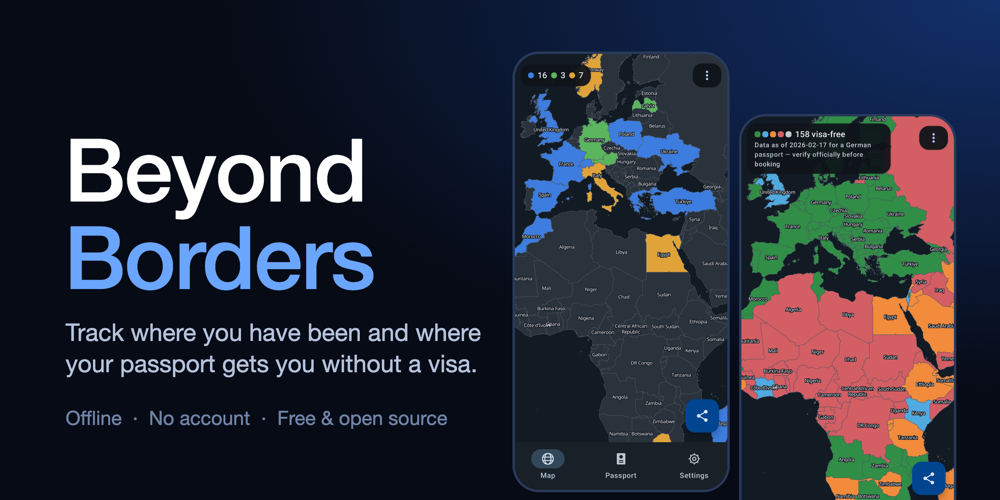
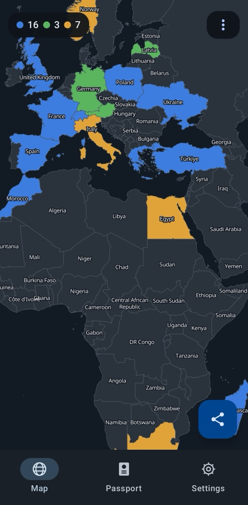
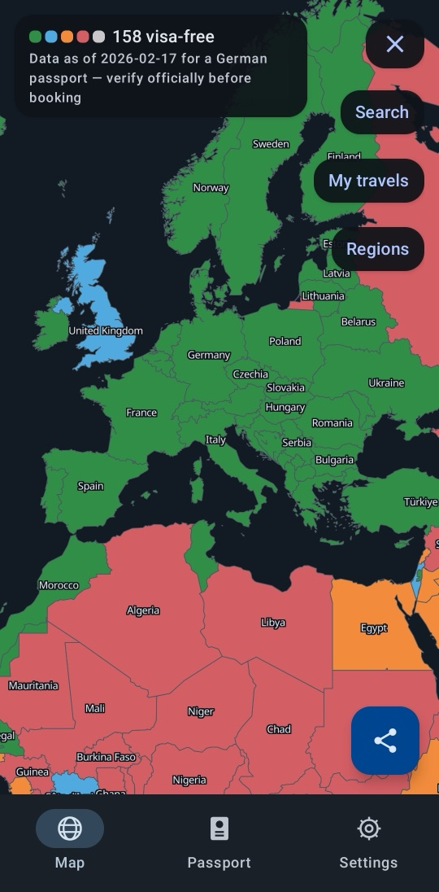
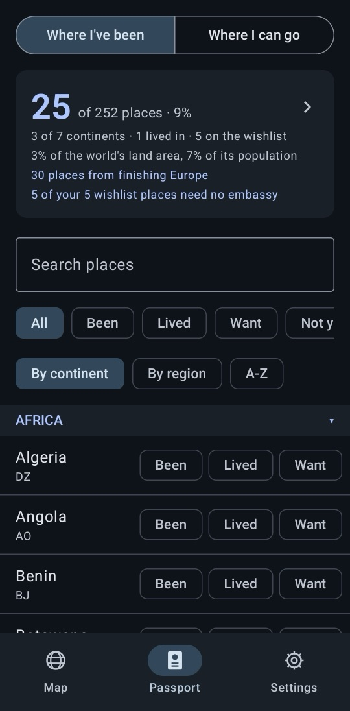
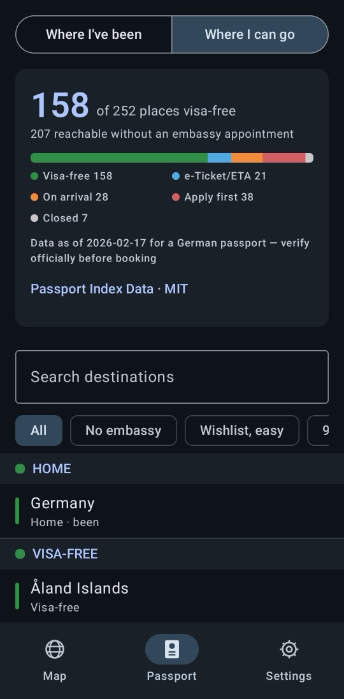
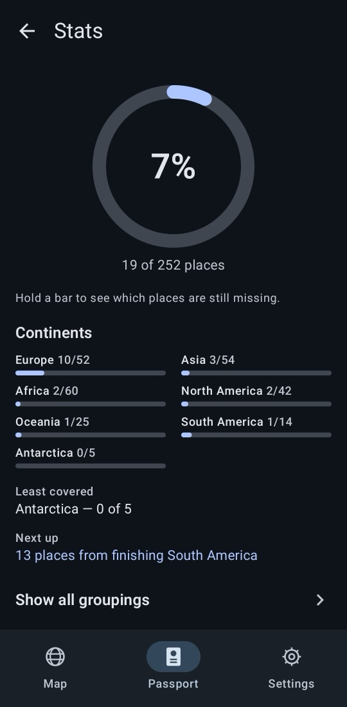

An Android app for tracking where you have been and where your passport gets you
without a visa. Offline, no account, no network permission.

**Needs Android 11+ on an arm64 phone** (no x86 emulators). Install steps are [below](#install).

[](https://github.com/Riedel-David/Beyond-Borders/releases/download/v0.7.19/BeyondBorders-0.7.19.apk)

[](https://github.com/Riedel-David/Beyond-Borders/actions/workflows/ci.yml)


<table>
  <tr>
    <td align="center"><br><sub>Travel map</sub></td>
    <td align="center"><br><sub>Visa lens</sub></td>
    <td align="center"><br><sub>Passport list</sub></td>
    <td align="center"><br><sub>Where I can go</sub></td>
    <td align="center"><br><sub>Stats</sub></td>
  </tr>
</table>

[Install](#install) · [Features](docs/FEATURES.md) · [Privacy](docs/PRIVACY.md) · [Data](docs/DATA.md) · [Contributing](CONTRIBUTING.md)

## Why

Every travel tracker I tried selects more than you ask for — tap Denmark and you get
Greenland, tap France and you get French Guiana. Beyond Borders is built on a dataset
where those are separate places and on a data model with no parent-child link at all,
so a cascade is not a bug that was fixed, it is a thing the code cannot express.

## Features

- **Travel map** — 252 places, tap to select, Been / Lived / Want, a visa lens and a
  region-completion heatmap.
- **Passport list and stats** — search, filters, a passport card whose headline number
  opens a stats screen: per-continent bars, your least-covered continent, the next milestone.
- **Passport visas** — where any of about 200 passports goes, offline. DE gets a full
  252-place curated answer; a second passport is optional, and the easier of its two
  answers wins. A snapshot that can be out of date: confirm entry rules with
  [the official source](#data-and-licences) before you travel.
- **Share** — your travels as an image in one of three styles: the map with a caption bar,
  the map with a corner badge, or a numbers-only stats card.
- **Home-screen widget** — configurable per instance: headline metric and card background.
  It adds the logo, wordmark and stat tiles as it is resized. Tapping it opens the map, or
  the stats screen for the percent and continents widgets.
- **Settings** — theme, map colours, JSON export / import, restoring from Android's backup
  after a reinstall, and *Delete everything*, which clears your places, passports and
  display settings.

More detail in [docs/FEATURES.md](docs/FEATURES.md).

## Privacy

Everything stays on your phone. The app has no network permission, no account, no
basemap, no tile server and no API key; the geometry is bundled in the APK. Details in
the [privacy policy](docs/PRIVACY.md).

## Install

Download `BeyondBorders-<version>.apk` from the [Releases](../../releases) page. Requires
Android 11 (API 30) or newer on a 64-bit ARM (arm64) device, which is nearly every phone
from the last several years.

1. Open the APK on your phone. Android will ask you to allow installs from that
   app (your browser or file manager); this is the "install unknown apps" setting.
2. Play Protect may warn that the developer is unknown. To continue, tap
   **More details → Install anyway**; you only need to do this once. The APK is
   signed with a fixed key, so updates install over it.
3. To check the download, compare `sha256sum BeyondBorders-<version>.apk` with the
   contents of the `.sha256` file next to it.

The app has no network permission, so it cannot check for updates itself. Watch the
Releases page, or point [Obtainium](https://github.com/ImranR98/Obtainium) at this
repository to be notified of new versions (Obtainium is untested with this app's release
files, so treat that as a suggestion).

## Build and run

Requires a JDK 21 (Android Studio bundles one) and an arm64 device or emulator image
with API 30+. The APK is arm64-only and MapLibre needs Vulkan, so x86 emulator
images will not run it.

```sh
# macOS path shown; any JDK 21 works
export JAVA_HOME="/Applications/Android Studio.app/Contents/jbr/Contents/Home"

./gradlew :app:testDebugUnitTest        # host tests, no device needed
./gradlew :app:connectedDebugAndroidTest # needs a device: DB migrations, deviceId storage
./gradlew :app:installDebug              # build + install
```

The unit tests are the useful ones to run first: they read the shipped geo and visa
assets directly and assert the territory splits, the visa coverage and the colour
contrast, so they catch a broken dataset without launching anything.

**Tech stack:** Kotlin, Jetpack Compose with Material 3, Room (KSP), MapLibre Native.
Manual dependency injection, no Hilt. Reference data is generated by Python scripts under
`tools/` and bundled as assets.

## Guides

- [Features in depth](docs/FEATURES.md) — map colours, how passport answers work,
  export and import.
- [Data and regenerating assets](docs/DATA.md) — rebuilding the geo and visa assets.
- [Asset sources](ASSET_SOURCES.md) — provenance and checksums of every bundled asset.
- [Contributing](CONTRIBUTING.md), [Security](SECURITY.md), [Privacy policy](docs/PRIVACY.md).

## Data and licences

Visa rules change often and the visa data is bundled with each release, so it can be out
of date. Check the official sources of your destination before you travel.

Boundaries come from [Natural Earth](https://www.naturalearthdata.com/) (public domain),
visa requirements from the [Visa-requirements dataset](https://github.com/Riedel-David/Visa-requirements)
(derived from Wikipedia contributors, CC BY-SA 4.0) plus hand-curated territory answers of our own, and map labels use Noto Sans
(SIL OFL 1.1). Map rendering is [MapLibre Native Android](https://github.com/maplibre/maplibre-native)
(BSD-2-Clause). Travel-advice links come from the German Federal Foreign Office's open
data, used at build time only. Provenance and checksums are in
[ASSET_SOURCES.md](ASSET_SOURCES.md); the full notices, including the upstream copyright
text, are in [THIRD_PARTY_NOTICES.md](THIRD_PARTY_NOTICES.md).

## Licence

The code is licensed under the [GNU GPL v3](LICENSE). The bundled data keeps its own licences, listed above. Licence texts and upstream copyright notices are in [THIRD_PARTY_NOTICES.md](THIRD_PARTY_NOTICES.md).
